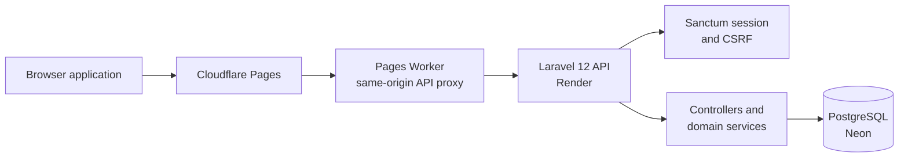

# SpendSense — Backend

A Laravel API for **SpendSense**, a personal-finance application for tracking income and expenses, managing budgets, and reviewing financial activity.

<p>
  <a href="https://spendsensehq.pages.dev"></a>
  <a href="https://github.com/ThunderSkull7/spendsense-backend/actions/workflows/ci.yml"></a>
  <a href="CHANGELOG.md"></a>
  <a href="LICENSE"></a>
  
  
  
  
</p>

> This repository contains the backend API. The browser application is maintained separately in [spendsense-frontend](https://github.com/ThunderSkull7/spendsense-frontend).

## Project links

| Resource | Link |
|---|---|
| Live application | https://spendsensehq.pages.dev |
| Frontend repository | [ThunderSkull7/spendsense-frontend](https://github.com/ThunderSkull7/spendsense-frontend) |
| Backend repository | [ThunderSkull7/spendsense-backend](https://github.com/ThunderSkull7/spendsense-backend) |
| Architecture guide | [docs/ARCHITECTURE.md](docs/ARCHITECTURE.md) |
| API reference | [docs/API.md](docs/API.md) |
| Database design | [docs/DATABASE.md](docs/DATABASE.md) |
| Authentication guide | [docs/AUTHENTICATION.md](docs/AUTHENTICATION.md) |
| Release & versioning | [docs/RELEASES.md](docs/RELEASES.md) |
| Changelog | [CHANGELOG.md](CHANGELOG.md) |
| Contributor guide | [CONTRIBUTING.md](CONTRIBUTING.md) |
| Security policy | [SECURITY.md](SECURITY.md) |
| Code of conduct | [CODE_OF_CONDUCT.md](CODE_OF_CONDUCT.md) |
| Issues and feature requests | [GitHub Issues](https://github.com/ThunderSkull7/spendsense-backend/issues) |

## Application preview

While this repository contains the headless Laravel REST API, it powers the fully responsive **SpendSense** web application. Below is a preview of the frontend interface powered by these backend services:

| Financial dashboard | Expense management |
|:---:|:---:|
| [](https://spendsensehq.pages.dev) | [](https://spendsensehq.pages.dev) |
| **Cash-flow & budget tracking**<br>Powered by `/api/analytics/*` & `/api/budgets` | **Transaction ledger & soft deletes**<br>Powered by `/api/expenses` & `/api/categories` |

| Financial reports & analytics | Mobile experience |
|:---:|:---:|
| [](https://spendsensehq.pages.dev) | [](https://spendsensehq.pages.dev) |
| **Period analysis & CSV exports**<br>Powered by `/api/reports` & `/api/transactions/export` | **Responsive mobile interface**<br>Powered by `/api/dashboard/preferences` & `/user` |

> Explore the complete visual showcase and UI implementation in the [spendsense-frontend](https://github.com/ThunderSkull7/spendsense-frontend) repository or experience the live application at [spendsensehq.pages.dev](https://spendsensehq.pages.dev).

## Overview

SpendSense provides a first-party web experience backed by a Laravel API. The backend owns authentication, validation, financial domain operations, persistence, and reporting. It is designed around explicit domain services and database-enforced integrity rather than placing all business rules in controllers.

## Core capabilities

The API currently includes functionality for:

- **Authentication and profile:** registration, login, logout, session hydration, and profile updates using Laravel Sanctum.
- **Financial records:** income and expense creation, retrieval, updates, deletion, and restoration.
- **Budgets and categories:** budget management, category ownership rules, and budget threshold alerts.
- **Recurring activity:** recurring income and expense schedules, previews, occurrences, and lifecycle operations.
- **Savings goals:** goal management, contributions, and corrections.
- **Analysis and reporting:** reports, transaction search, cash-flow forecasts, and spending analysis endpoints.
- **Data operations:** CSV import and full data export.
- **Reliability controls:** optional idempotency keys for selected write operations and database constraints for important invariants.

The exact endpoint contract is defined in `routes/api.php`; treat that file and the request/controller implementation as authoritative.

## Engineering highlights

### Domain-oriented service layer

Controllers delegate substantial financial operations to dedicated services. This keeps business rules reusable and separates HTTP concerns from domain operations.

### Idempotent write requests

Selected create and financial-operation routes use the `idempotent` middleware. When a client supplies an `Idempotency-Key`, the middleware scopes the record to the authenticated user and operation, hashes the request payload, and replays a completed successful response for a matching retry. Reusing a key with a different payload produces a conflict response.

Clients may omit the header; the middleware preserves the existing request flow in that case.

### Database-backed integrity

Migrations define relational constraints and indexes for financial records. PostgreSQL-specific integration tests cover selected database behavior and concurrency-sensitive flows. Application validation complements rather than replaces database integrity rules.

### Session-based first-party authentication

The API uses Laravel Sanctum with session cookies and CSRF protection for the first-party browser application. The frontend deployment uses a same-origin Cloudflare Pages Worker proxy to route browser API requests to the backend.

## Architecture



The Worker is part of the frontend deployment process; its generated source is produced by the frontend deployment preparation script. See the [frontend repository](https://github.com/ThunderSkull7/spendsense-frontend) for its implementation and deployment workflow.

## Technology

| Area | Technology |
|---|---|
| Language | PHP 8.2+ |
| Framework | Laravel 12 |
| Authentication | Laravel Sanctum |
| Persistence | PostgreSQL; SQLite for the default test configuration |
| Testing | Pest 3 / Laravel test tooling |
| Dependency management | Composer |
| Deployment | Docker-based backend deployment; Render hosting |

## Getting started

### Prerequisites

- PHP 8.2 or later with the required Laravel extensions
- Composer
- Node.js and npm (for the Laravel/Vite asset toolchain)
- SQLite for a simple local setup, or PostgreSQL for PostgreSQL-specific development and testing

### 1. Clone and install

```bash
git clone https://github.com/ThunderSkull7/spendsense-backend.git
cd spendsense-backend
composer install
```

### 2. Configure the environment

```bash
cp .env.example .env
php artisan key:generate
```

The committed `.env.example` defaults to SQLite. Configure the database values for your local environment as needed. Never commit real database credentials, application keys, or production secrets.

### 3. Prepare the database

For the default SQLite configuration, create the database file if it does not exist:

```bash
mkdir -p database
touch database/database.sqlite
php artisan migrate
```

On Windows PowerShell:

```powershell
New-Item -ItemType Directory -Force database | Out-Null
New-Item -ItemType File -Force database/database.sqlite | Out-Null
php artisan migrate
```

### 4. Run the API

```bash
php artisan serve --host=127.0.0.1 --port=8002
```

The local API is then available at `http://127.0.0.1:8002`.

### 5. Run tests

```bash
composer test
# or
php vendor/bin/pest
```

The default Pest test suite executes in-memory SQLite tests covering authentication, financial domain operations, date boundaries, and data safety. PostgreSQL integration tests run in CI against a disposable PostgreSQL service to verify database constraints, composite indexes, and transaction safety.

## Frontend integration

The frontend repository is configured to use the local API origin `http://127.0.0.1:8002` during development. Follow the frontend repository's setup instructions for serving the static application and configuring the browser-facing API origin.

In production, the frontend is served from Cloudflare Pages and its Worker proxies allowed API paths to the Laravel service on Render. The browser remains on the Pages origin for cookie and CSRF compatibility.

## Repository map

```text
app/
  Http/
    Controllers/     # HTTP endpoints
    Middleware/      # Cross-cutting request behavior (idempotency, auth)
    Requests/        # Request validation
  Models/            # Eloquent models
  Services/          # Financial and domain operations
  Support/           # Shared domain helpers
database/
  migrations/        # Schema and integrity changes
  factories/
  seeders/
docs/                # Architecture, API, database, and release documentation
routes/
  api.php            # API route contract
  web.php
tests/
  Feature/           # Pest feature and integration tests
  Unit/              # Domain unit tests
docker/
.github/workflows/   # CI and deployment workflows
```

## API documentation

The route definitions and Laravel request/controller classes are the source of truth for the API contract. See [docs/API.md](docs/API.md) for endpoint documentation, parameter requirements, and JSON payloads.

## Development notes

- Use migrations for schema changes and include tests for affected invariants.
- Prefer focused domain services for business rules that span multiple endpoints.
- Add idempotency middleware only to operations where safe retry semantics are required.
- Keep credentials and environment-specific values in deployment secrets, never in committed source.
- Run the relevant SQLite and PostgreSQL test paths before proposing changes affecting persistence.

## CI and reliability status

GitHub Actions workflows are maintained under `.github/workflows/ci.yml`. The CI pipeline runs on every push and pull request to `main`, validating:
1. **Backend Tests (SQLite):** Pest unit and feature tests, scheduled commands smoke tests.
2. **Backend Tests (PostgreSQL):** PostgreSQL migration execution, relational constraints, and transaction tests.
3. **Dependency Security Audit:** `composer audit` verifying 0 vulnerable packages.

Check the [Actions tab](https://github.com/ThunderSkull7/spendsense-backend/actions) for real-time status.

## Contributing

Contributions and technical feedback are welcome! Please review our [Contributing Guide](CONTRIBUTING.md), [Security Policy](SECURITY.md), and [Code of Conduct](CODE_OF_CONDUCT.md) before submitting pull requests or opening issues.

## License

Distributed under the MIT License. See [LICENSE](LICENSE).
