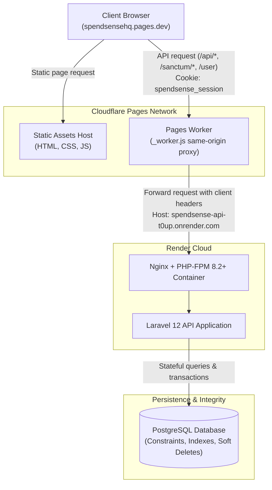
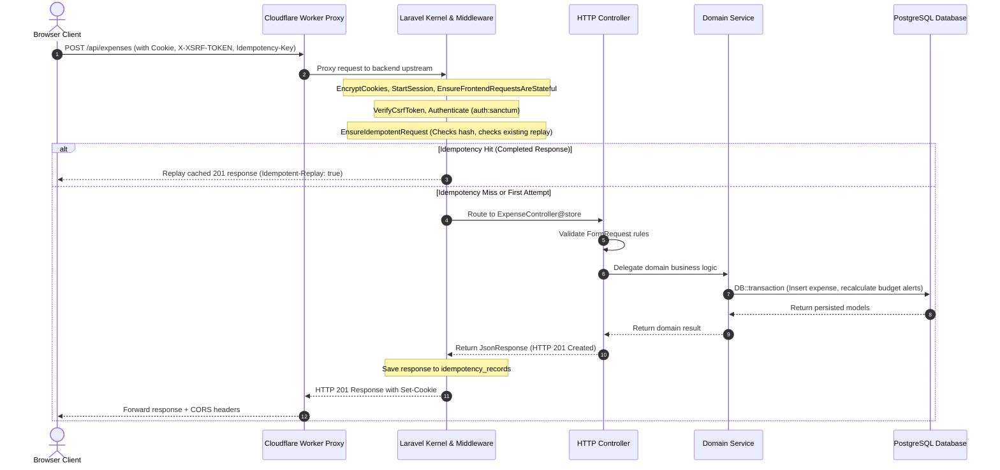
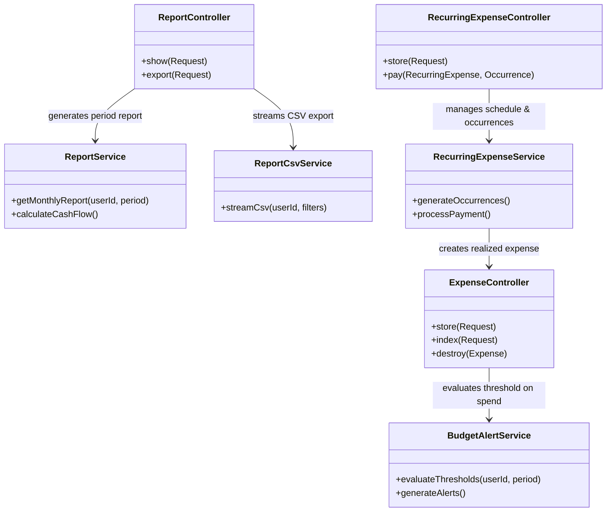
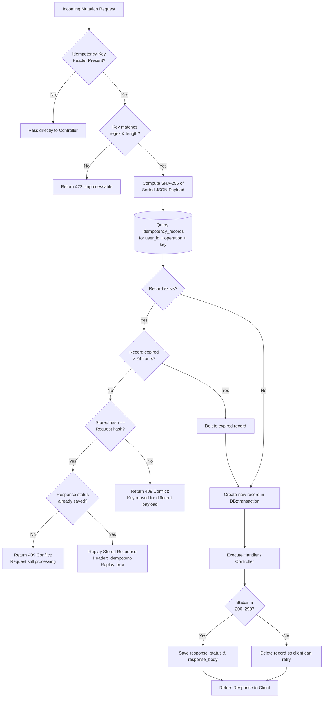

# SpendSense Backend — Architecture & System Design

This document details the architectural principles, request lifecycle, service layer decomposition, data persistence strategies, and reliability mechanisms of the SpendSense Laravel 12 REST API.

---

## 1. High-Level System Architecture

SpendSense follows a decoupled, headless client-server architecture. The browser frontend is deployed as a static multi-page application on Cloudflare Pages, backed by a Cloudflare Pages Worker that acts as a same-origin reverse proxy. The API is hosted on Render and communicates with a managed PostgreSQL database.



---

## 2. Request Lifecycle & Layered Responsibilities

The API enforces strict separation of concerns across distinct layers of the Laravel framework.



### Layer Responsibilities

| Architectural Layer | Implementation | Primary Responsibilities |
| :--- | :--- | :--- |
| **HTTP Routing** | `routes/api.php`, `routes/web.php` | Defines URL contract, HTTP methods, route parameter constraints (`[0-9]+`), throttling, and middleware binding. |
| **Middleware Pipeline** | `app/Http/Middleware/*`, Sanctum | Session extraction, CSRF verification, rate limiting, and request idempotency hashing. |
| **Request Validation** | Controllers & Form Validation | Syntactic validation, type casting, date boundary checks, and ownership verification. |
| **Controllers** | `app/Http/Controllers/*` | Lightweight HTTP coordinators; orchestrate request inputs, invoke domain services, and format JSON responses. |
| **Domain Services** | `app/Services/*` | Core business logic, multi-entity orchestration, date calculation, transaction isolation, and metric aggregations. |
| **Persistence (Models)** | `app/Models/*` | Eloquent ORM mapping, table relationships, attribute casting, and soft deletion scopes. |
| **Database Engine** | PostgreSQL (Neon / Docker) | Referential integrity (`FOREIGN KEY`), check constraints (`CHECK amount > 0`), unique indexes, and ACID guarantees. |

---

## 3. Domain Service Organization

Controllers in SpendSense remain thin by delegating complex financial logic to dedicated domain services located in `app/Services/`.



### Key Domain Services

1. **`ReportService` & `ReportCsvService`**:
   - Computes deterministic income, expense, and category-level aggregates across calendar periods.
   - Enforces date-inclusive boundaries (`start_date <= date <= end_date`) without timezone drift.
   - Ensures exported CSV figures match the on-screen report metrics exactly.
2. **`RecurringExpenseService` & `RecurringIncomeService`**:
   - Manages schedules (daily, weekly, biweekly, monthly, quarterly, yearly).
   - Generates planned occurrences without generating phantom ledger rows.
   - Reconciles realized transactions upon occurrence payment/receipt.
3. **`BudgetAlertService` & `BudgetPerformanceService`**:
   - Evaluates monthly spending against user-defined budget thresholds (e.g. 50%, 80%, 100%, 120%).
   - Creates distinct in-app alert records without duplicates.
4. **`CashFlowForecastService` & `SpendingInsightsService`**:
   - Computes expected cash-flow trajectories combining historical averages with active recurring schedules.
   - Separates "actual" ledger data from "expected" projections.
5. **`SubscriptionService`**:
   - Tracks fixed recurring digital commitments. Prevents duplicate obligation counting by linking with bill schedules.
6. **`NetWorthService`**:
   - Implements append-only asset and liability valuation tracking over time.

---

## 4. Idempotency Mechanism & Write Safety

Network timeouts and mobile retries can cause duplicate financial operations. SpendSense protects write operations using the `EnsureIdempotentRequest` middleware (`app/Http/Middleware/EnsureIdempotentRequest.php`).

### Idempotency Flow



### Idempotency Scope

- **Key Header:** `Idempotency-Key: <UUID or token>` (1–128 characters: `^[A-Za-z0-9._:-]+$`).
- **Scoping Key:** Scoped strictly to `(user_id, operation, idempotency_key)` where `operation` is `METHOD /path`.
- **TTL:** Records expire automatically after 24 hours (`now()->addDay()`).
- **Failure Recovery:** If a mutation returns a validation error (422) or server error (500), the idempotency record is deleted so the client can fix invalid parameters and retry using the same key.

---

## 5. Database Integrity & Concurrency

The database is treated as the final authority on data consistency, rather than relying solely on application-level checks.

### Concurrency & Relational Controls

1. **Foreign Key Constraints with Cascade Rules:**
   - Financial records (`expenses`, `incomes`) reference `users(id)` and `categories(id)`.
   - Category deletion enforces owner checks; default shared categories (`is_default: true`) cannot be deleted or renamed.
2. **PostgreSQL Check Constraints:**
   - `incomes_amount_positive`: `CHECK (amount > 0)`
   - `expenses_amount_positive`: `CHECK (amount > 0)`
   - `recurring_incomes_date_order`: `CHECK (end_date >= start_date)`
   - `recurring_incomes_status_check`: `CHECK (status IN ('active', 'paused', 'stopped'))`
   - `recurring_occurrences_receipt_link`: `CHECK ((status = 'received') = (income_id IS NOT NULL))`
3. **Database Transactions:**
   - Multi-step write operations (e.g. marking a bill as paid, importing CSV rows, or logging savings contributions) execute within explicit `DB::transaction()` blocks.
4. **Soft Deletes:**
   - Financial ledgers (`expenses`, `incomes`) use Laravel's `SoftDeletes` trait, preserving transaction audit history while allowing user-driven deletion and restoration via `/trash` and `/restore`.

---

## 6. Error Handling & Response Standards

SpendSense enforces consistent JSON error response envelopes across all endpoints:

### Standard Error Response Format

```json
{
  "message": "The given data was invalid.",
  "errors": {
    "amount": [
      "The amount field must be greater than 0."
    ],
    "category_id": [
      "The selected category is invalid or belongs to another user."
    ]
  }
}
```

### HTTP Status Code Conventions

| Status Code | Meaning in SpendSense |
| :--- | :--- |
| `200 OK` | Successful read, update, or idempotent replay. |
| `201 Created` | Successful creation of a new financial record. |
| `204 No Content` | Successful deletion or CSRF cookie initialization. |
| `401 Unauthorized` | Unauthenticated request or expired session. |
| `403 Forbidden` | Authenticated user lacks permission to access the specified resource. |
| `404 Not Found` | Entity does not exist or does not belong to the authenticated user. |
| `409 Conflict` | Idempotency key conflict (payload mismatch or concurrent execution). |
| `419 Page Expired` | CSRF token mismatch or stale cookie. |
| `422 Unprocessable` | Input validation failure. |
| `429 Too Many Requests` | Throttling limit exceeded. |
| `500 Server Error` | Unexpected backend runtime exception. |
