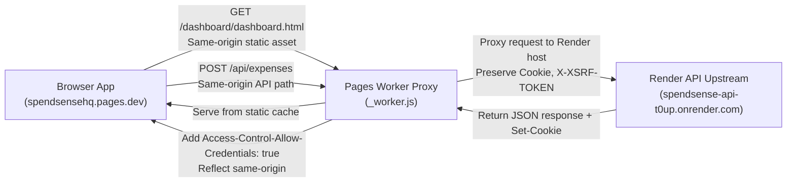

# SpendSense Backend — Authentication & Session Architecture

This document explains the authentication architecture, CSRF lifecycle, cookie configuration, and same-origin reverse proxy integration between the SpendSense frontend and Laravel API.

---

## 1. Authentication Strategy

SpendSense uses **first-party session-based authentication** powered by [Laravel Sanctum](https://laravel.com/docs/12.x/sanctum). Instead of sending Bearer tokens in headers, authentication is maintained using encrypted HTTP cookies:

1. **`spendsense_session`**: The encrypted Laravel session cookie identifying the authenticated user session.
2. **`XSRF-TOKEN`**: A readable CSRF cookie containing the current CSRF token, refreshed automatically across requests.

```mermaid
sequenceDiagram
    autonumber
    actor Browser as User Browser
    participant Worker as Cloudflare Pages Worker
    participant Backend as Laravel 12 API (Render)

    Note over Browser,Backend: Step 1: CSRF Initialization
    Browser->>Worker: GET /sanctum/csrf-cookie
    Worker->>Backend: Forward to /sanctum/csrf-cookie
    Backend-->>Worker: HTTP 204 No Content<br/>Set-Cookie: XSRF-TOKEN=xyz; Path=/; SameSite=Lax
    Worker-->>Browser: Forward response with Set-Cookie

    Note over Browser,Backend: Step 2: Login Authentication
    Browser->>Worker: POST /api/login<br/>Header: X-XSRF-TOKEN: xyz<br/>Body: {"email": "...", "password": "..."}
    Worker->>Backend: Forward request with cookies and headers
    Backend->>Backend: Validate credentials & regenerate session
    Backend-->>Worker: HTTP 200 OK<br/>Set-Cookie: spendsense_session=abc; Path=/; HttpOnly; Secure<br/>Set-Cookie: XSRF-TOKEN=fresh_token; Path=/
    Worker-->>Browser: Forward response with updated cookies & user payload

    Note over Browser,Backend: Step 3: Authenticated Request
    Browser->>Worker: GET /api/expenses<br/>Cookie: spendsense_session=abc
    Worker->>Backend: Forward request with session cookie
    Backend->>Backend: Authenticate user via Sanctum guard
    Backend-->>Worker: HTTP 200 OK (User Expense Data)
    Worker-->>Browser: HTTP 200 OK
```

---

## 2. CSRF Lifecycle & Token Rotation

Laravel Sanctum guards against Cross-Site Request Forgery (CSRF) for all stateful requests (`POST`, `PUT`, `PATCH`, `DELETE`).

### Flow
1. **Bootstrap:** The frontend requests `GET /sanctum/csrf-cookie`. Laravel emits an unencrypted `XSRF-TOKEN` cookie.
2. **Token Injection:** The client JavaScript reads `document.cookie` for `XSRF-TOKEN` and attaches it as the `X-XSRF-TOKEN` HTTP request header for mutation requests.
3. **Session Rotation:** On successful login or logout, Laravel calls `$request->session()->regenerate()`, changing the session ID and issuing a fresh CSRF token.
4. **Client Stale Token Handling:** If a request receives an HTTP `419 Page Expired` response due to a stale token, the frontend API client automatically invokes `fetchXSRFToken()` and retries the mutation once before reporting an error.

---

## 3. Same-Origin Architecture & Cloudflare Worker Proxy

Browsers enforce strict cross-site cookie restrictions (such as `SameSite=Lax` or `SameSite=Strict`, and third-party cookie blocking).

If the browser application at `https://spendsensehq.pages.dev` made direct cross-origin AJAX calls to `https://spendsense-api-t0up.onrender.com`, cookies would be treated as third-party, causing session dropping and authentication failures.

### The Solution: Same-Origin Reverse Proxy
The SpendSense frontend deployment script (`deploy/prepare-frontend-deploy.js`) compiles a Cloudflare Pages Worker (`_worker.js`) that sits on the frontend domain:



### Path Allowlist
Only specific path prefixes are proxied to the backend:
- `/api/*`
- `/sanctum/*`
- `/user` (exact session hydration route)

All other paths are routed directly to Cloudflare Pages static asset storage via `env.ASSETS.fetch(request)`.

---

## 4. Common Authentication Issues & Troubleshooting

### 1. HTTP 419 (Page Expired / CSRF Token Mismatch)
- **Cause:** The `X-XSRF-TOKEN` header is missing, expired, or does not match the decrypted session CSRF token.
- **Remedy:** Ensure the client calls `/sanctum/csrf-cookie` before making mutation requests. The frontend API client in `script.js` automatically recovers from this with a single transparent retry.

### 2. HTTP 401 (Unauthorized on Authenticated Routes)
- **Cause:** Missing or expired `spendsense_session` cookie, or cross-origin request stripped cookies.
- **Remedy:**
  - Verify `credentials: 'include'` is passed to the JavaScript `fetch` call.
  - In local development, verify that the frontend is configured to point to `http://127.0.0.1:8002` and that cookies are not blocked by browser privacy extensions.
  - In production, verify that requests are sent through the Pages origin (`https://spendsensehq.pages.dev/api/...`) rather than directly to the Render origin.

### 3. Session Rotation & User Hydration
- After page reload, the frontend calls `GET /api/user` (or `GET /user`).
- If valid, the backend returns the authenticated `User` JSON object.
- If invalid or expired, the backend returns HTTP 401, triggering the frontend to dispatch the `spendsense:session-expired` event and redirect to `authentication/login.html`.
