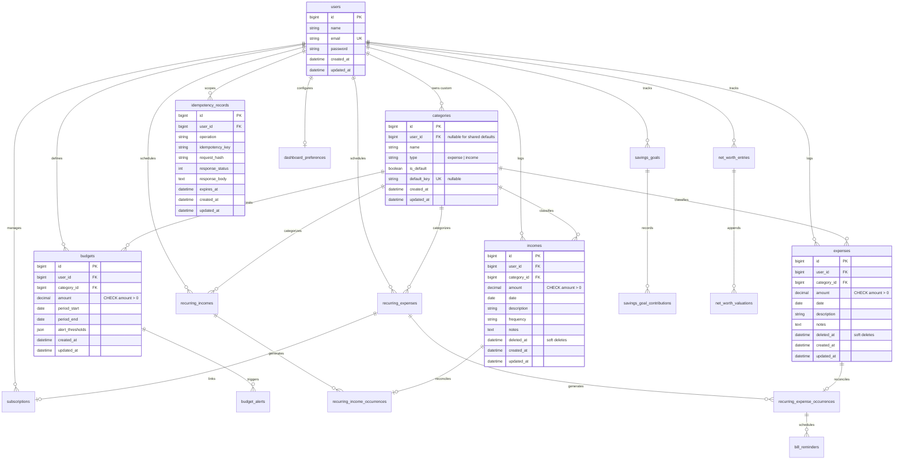

# SpendSense Backend — Database Design & Schema Reference

This document details the relational schema, constraints, indexing strategies, financial integrity rules, and database engine considerations for SpendSense.

---

## 1. Entity-Relationship Diagram



---

## 2. Table Specifications & Integrity Constraints

### 1. `users`
- Stores primary user identity and authentication credentials.
- **Unique Constraints:** `users_email_unique` (`email`). Note: Email casing is normalized using `Str::lower()` prior to validation and lookups to ensure case-insensitive semantics on PostgreSQL.

### 2. `categories`
- Dual-mode category taxonomy supporting shared defaults alongside user-private categories.
- **Fields:** `id`, `user_id` (nullable FK), `name`, `type` (`expense` or `income`), `is_default` (boolean), `default_key` (nullable string).
- **Integrity Rules:**
  - *Shared Defaults:* `user_id` is `NULL`, `is_default` is `true`, `default_key` is populated (e.g. `expense:food-dining`). Protected against user modification or deletion.
  - *User Custom:* `user_id` points to the owner, `is_default` is `false`, `default_key` is `NULL`.
  - **Unique Constraints:**
    - `default_key` unique index (allows multiple `NULL`s for custom categories).
    - `categories_user_name_type_unique` (`user_id`, `name`, `type`) prevents name collisions within a user's private space.

### 3. `expenses` & `incomes`
- Core financial ledger tables recording realized transactions.
- **Fields:** `id`, `user_id` (FK), `category_id` (FK), `amount` (decimal 12,2), `date` (date), `description` (string), `notes` (nullable text), `deleted_at` (nullable timestamp for soft deletes).
- **PostgreSQL Check Constraints:**
  - `expenses_amount_positive`: `CHECK (amount > 0)`
  - `incomes_amount_positive`: `CHECK (amount > 0)`
- **Reporting Indexes:** Composite indexes on `(user_id, date)` and `(user_id, category_id, date)` guarantee sub-millisecond range scans for period reports and monthly analytics.

### 4. `budgets`
- User-defined spending limits per category for calendar periods.
- **Fields:** `id`, `user_id` (FK), `category_id` (FK), `amount` (decimal 12,2), `period_start` (date), `period_end` (date), `alert_thresholds` (JSON array: e.g. `[50, 80, 100, 120]`).
- **Integrity Constraints:**
  - `budgets_user_category_period_unique`: Unique on `(user_id, category_id, period_start, period_end)` preventing duplicate budgets for the same category in the same month.
  - `CHECK (amount > 0)` ensures non-negative budget thresholds.

### 5. `recurring_incomes` & `recurring_expenses`
- Schedule templates for automated occurrence generation (bills, salary, subscriptions).
- **Fields:** `id`, `user_id`, `category_id`, `amount`, `frequency` (`daily`, `weekly`, `biweekly`, `monthly`, `quarterly`, `half-yearly`, `yearly`), `start_date`, `end_date`, `status` (`active`, `paused`, `stopped`).
- **Check Constraints (PostgreSQL):**
  - `CHECK (amount > 0)`
  - `CHECK (end_date >= start_date)`
  - `CHECK (status IN ('active', 'paused', 'stopped'))`

### 6. `recurring_income_occurrences` & `recurring_expense_occurrences`
- Individual projected occurrences materialized from recurring schedules.
- **Fields:** `id`, schedule foreign key, transaction foreign key (`expense_id` or `income_id`, nullable until paid), `expected_amount`, `due_date`, `status` (`planned`, `paid`/`received`, `skipped`/`cancelled`).
- **PostgreSQL Check Constraint:**
  - `CHECK ((status = 'received') = (income_id IS NOT NULL))` enforces that an occurrence is marked received if and only if it links to a valid realized income ledger row.

### 7. `idempotency_records`
- Atomic record log backing the `EnsureIdempotentRequest` middleware.
- **Fields:** `id`, `user_id` (FK), `operation` (string 190), `idempotency_key` (string 128), `request_hash` (string 64 SHA-256), `response_status` (nullable int), `response_body` (nullable text), `expires_at` (datetime).
- **Unique Constraint:** `idempotency_records_user_operation_key_unique` on `(user_id, operation, idempotency_key)`.

---

## 3. Database Engine Differences: SQLite vs PostgreSQL

SpendSense is tested against both SQLite (in-memory test speed) and PostgreSQL (production parity). Understanding engine differences is critical:

| Feature / Behavior | SQLite (Local / Unit Tests) | PostgreSQL (Production / Integration) |
| :--- | :--- | :--- |
| **String Comparisons** | Case-insensitive for ASCII strings by default (`LIKE` and `=`). | Case-sensitive by default. Email uniqueness and lookups use `Str::lower()`. |
| **Alter Table Constraints** | Does not support `ALTER TABLE ADD CONSTRAINT` after creation. | Enforces strict `CHECK`, `NOT VALID`, and partial indexes. |
| **Date Functions** | String-based date parsing (`strftime`). | Rich date and timestamp types (`DATE`, `TIMESTAMPTZ`), strict interval arithmetic. |
| **Foreign Keys** | Disabled by default in SQLite CLI (enabled in Laravel via connection config). | Native relational integrity with cascade options (`ON DELETE RESTRICT`, `NULL ON DELETE`). |
| **Locking & Concurrency** | Database-level lock during write transactions. | Row-level locking (`SELECT ... FOR UPDATE`), MVCC isolation. |

---

## 4. Migration & Maintenance Workflow

- **Creating Migrations:**
  ```bash
  php artisan make:migration add_new_feature_table
  ```
- **Driver-Guarded Statements:** Schema additions that rely on PostgreSQL-specific features must check the driver to ensure SQLite compatibility during unit tests:
  ```php
  if (DB::getDriverName() === 'pgsql') {
      DB::statement('ALTER TABLE expenses ADD CONSTRAINT expenses_amount_positive CHECK (amount > 0)');
  }
  ```
- **Safe Production Execution:** Migrations are executed with preflight checks in the deployment pipeline. Do not run destructive down-migrations against production without taking a database snapshot.
